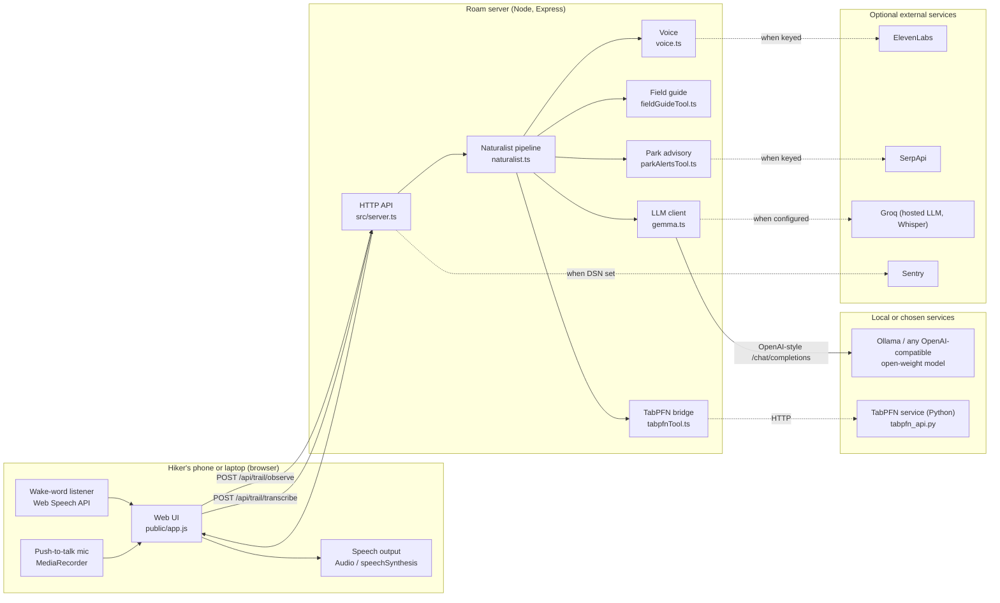
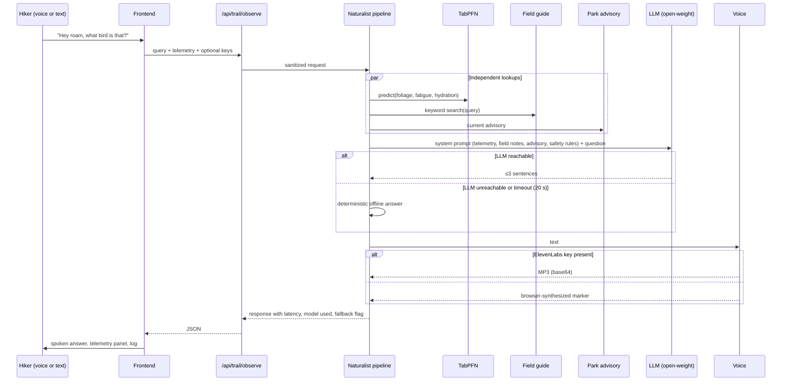

# Roam Architecture

Version 1.1. This document describes the system as implemented, separates what is working from what is planned, and records the trade-offs behind the main decisions.

---

## 1. Goals and constraints

| Goal                                              | Constraint it imposes                                                                                                                 |
| :------------------------------------------------ | :------------------------------------------------------------------------------------------------------------------------------------ |
| The screen is the shortest part of the experience | Responses must be short enough to hear comfortably: at most three sentences, and the wake word must work without looking at the phone |
| Works in the backcountry                          | The core path (local model, field guide, offline fallback answers) must run with no network                                           |
| Open pieces do real work                          | The LLM, the tabular model, and the speech stack must be swappable, not hard-wired to a vendor                                        |
| Trustworthy around food and safety                | The model must never certify a wild food as edible, and emergencies must route to emergency services                                  |
| Hackathon-scale deployable                        | A free-tier cloud deployment must work, degrading gracefully when optional services are missing                                       |

---

## 2. System context

**Reading the diagram:** solid arrows are always present. Dashed arrows are optional and each has a fallback. If every optional service is missing, the app still answers from the local field guide, the heuristic TabPFN fallback, and the browser's built-in speech.

---

## 3. Components

### 3.1 Frontend (`public/`)

| File         | Responsibility                                                                     |
| :----------- | :--------------------------------------------------------------------------------- |
| `index.html` | Layout, the hands-free control, the telemetry panel, and the settings drawer       |
| `app.js`     | State machine for hike sessions, the wake word, push-to-talk, and calls to the API |
| `style.css`  | Styling, including `.btn-wake` and `.wake-row` for the hands-free control          |

The frontend holds all user-specific state: the hike status, the telemetry sliders, and the optional API keys in `localStorage`. The server holds none.

### 3.2 HTTP API (`src/server.ts`)

Express app with five routes. See [API.md](API.md) for shapes.

- `GET /health`: liveness check for Render
- `GET /api/config`: assistant name, wake words, and which server-side services are configured. Contains no secrets.
- `POST /api/trail/observe`: the main pipeline
- `POST /api/trail/transcribe`: server-side Whisper fallback
- `POST /api/trail/sync`: checkpoint endpoint (stub)

**Request handling rules:**

- Keys in the request body are used for that request only and are never assigned to `process.env`. In v1.0 they were, which let one user's key become another user's default.
- Telemetry is clamped to physical ranges (`sanitizeTelemetry`). Query text is capped at 500 characters.
- Query text and API keys are not logged. Only the model name, endpoint type, and whether a key was supplied are logged.

### 3.3 Naturalist pipeline (`src/mastra/agents/naturalist.ts`)

The pipeline is a hand-written orchestrator. It is not Mastra-based (see §8).

Steps 1–3 run concurrently with `Promise.all`. In v1.0 they ran sequentially. Park advisories were fetched and then ignored, so they never reached the answer. In v1.1 they are part of the model's prompt.

### 3.4 Open-weight LLM client (`src/services/gemma.ts`)

Provider-neutral. The client sends a standard `/chat/completions` request to whatever endpoint is configured.

**Resolution order** for each setting (`resolveLLMConfig`):

| Setting  | Order                                                                                    |
| :------- | :--------------------------------------------------------------------------------------- |
| Base URL | request body → `LLM_BASE_URL` → `GEMMA_API_BASE` → `http://localhost:11434/v1`           |
| Model    | request body → `LLM_MODEL` → `GEMMA_MODEL` → `gemma2:9b`                                 |
| API key  | request body → `LLM_API_KEY` → `GROQ_API_KEY` → none (no `Authorization` header is sent) |

**Prompt design:**

- The persona is set by `ASSISTANT_NAME`.
- Current telemetry, TabPFN outputs, park advisory, and field-guide notes are included as grounding.
- Seven rules govern behaviour. The two that matter most on a trail: never certify a wild food as safe based on a description, and direct anyone reporting an injury or being lost to emergency services first.
- `max_tokens: 160`, `temperature: 0.6`, and a 20-second timeout. Trail connections are poor, so a stalled request must fail fast into the fallback.

**Failure behaviour:** any failure (connection refused, non-2xx status, timeout, empty content) returns a deterministic offline answer with `usedFallback: true`. The UI shows which path produced the answer. The client never throws into the pipeline.

### 3.5 TabPFN bridge (`src/mastra/tools/tabpfnTool.ts` and `services/`)

Three tiers, tried in order:

1. **HTTP** to `TABPFN_SERVICE_URL` (persistent `tabpfn_api.py`). Model loaded once. 4-second timeout.
2. **CLI** spawn of `services/tabpfn_service.py`. Refits on every call. Adequate for demos. 20-second timeout.
3. **Heuristic** fallback in TypeScript. Labelled `Heuristic fallback` in the output.

Inside the Python service (`tabpfn_service.py`), the predictor selects an engine and reports it:

| `engine`    | When                                          | Notes                                                                               |
| :---------- | :-------------------------------------------- | :---------------------------------------------------------------------------------- |
| `tabpfn`    | `tabpfn` package imports and its weights load | Prior Labs TabPFN, in-context learning, CPU. Requires PyTorch and a model download. |
| `sklearn`   | TabPFN unavailable                            | Random forest (foliage) and gradient boosting (fatigue). Tested here.               |
| `heuristic` | No training CSV                               | Rule-based, labelled as such.                                                       |

**Important limitation:** `data/trail_telemetry.csv` is synthetic. `services/generate_data.py` labels each row with hand-written rules, so every engine learns those rules. The predictions show how the pipeline works, but they are not field measurements. Replacing the CSV with real observations is the highest-value data task on the roadmap (§9).

**Why TabPFN is a fit for this problem:** a hiking club might have a few hundred labelled observations, which is too few for a conventional model to tune but right in TabPFN's range. In-context learning means adding a new site or season does not require retraining or hyperparameter search.

### 3.6 Field guide (`src/mastra/tools/fieldGuideTool.ts`)

Keyword-scored retrieval over a curated list. Each entry has names, a sound or appearance cue, a field note, optional safety text, and a keyword list. The query is tokenised, stopwords are removed, and each entry scores one point per matching token. The top three are returned.

In v1.0, the lookup matched the entire question as a substring, so "what bird is that singing in the oaks?" returned two default entries. In v1.1 it returns the Nuthatch, Chickadee, and Bluebird.

**Extending it:** add an object to `FIELD_DATABASE`. Write the safety note for any species that has look-alikes. Keep the database local so it works offline. Plan for a regional pack per park or club.

### 3.7 Voice (`src/services/voice.ts`)

- With an ElevenLabs key (server or per request): returns MP3 as base64.
- Without one, or if the API fails: returns `browser-synthesized`, and the frontend speaks using `speechSynthesis`.

### 3.8 Observability (`src/observability/sentry.ts`)

`traceAgentSpan` wraps the pipeline in a Sentry span and captures exceptions. It is inert without `SENTRY_DSN`. The UI's log shows measured latency and which model answered. v1.0 printed a hard-coded "240 ms" and a random trace ID, both of which were fabricated.

### 3.9 Durable sync (`src/workflows/trailSyncWorkflow.ts`)

**Stub.** The retry loop succeeds on the first iteration, and nothing is written anywhere. Responses are labelled `engine: "local-stub"` so the UI and any judges can see the status. See §9.

---

## 4. Voice input: two paths

| Path                 | How                                                                                                                                                          | Works in                                              | Needs                                             |
| :------------------- | :----------------------------------------------------------------------------------------------------------------------------------------------------------- | :---------------------------------------------------- | :------------------------------------------------ |
| Hands-free wake word | Continuous Web Speech recognition; the name switches the listener into capture mode                                                                          | Chrome and Edge, desktop and Android                  | Mic permission. Browser speech service            |
| Push-to-talk         | Tap the mic; browser speech runs in parallel with a `MediaRecorder` capture; if browser speech yields nothing, the recording goes to `/api/trail/transcribe` | Any modern browser (server fallback needs a Groq key) | Mic permission. Groq key for server transcription |

The wake-word state machine is covered in [WAKE_WORD.md](WAKE_WORD.md).

---

## 5. Failure modes

| Failure                         | Behaviour                                                                                                |
| :------------------------------ | :------------------------------------------------------------------------------------------------------- |
| No LLM endpoint reachable       | Offline deterministic answer. UI marks it as "offline naturalist"                                        |
| LLM slow (>20 s)                | Timeout and offline answer                                                                               |
| TabPFN service down             | Falls back to CLI, then heuristic                                                                        |
| Python not installed            | Heuristic values. Logged server-side                                                                     |
| ElevenLabs failure or quota     | Browser speech                                                                                           |
| SerpApi failure                 | Simulated advisory                                                                                       |
| Browser lacks Web Speech        | Wake-word control stays off and explains why (Chrome or Edge needed). Push-to-talk and typing still work |
| Mic permission denied           | Message explaining how to re-enable it                                                                   |
| Speaking while listening (echo) | Wake listener pauses while the assistant speaks                                                          |
| Recognition stops mid-session   | Auto-restart after 400 ms while hands-free is on                                                         |
| Transcription with no key       | HTTP 503 with a clear message                                                                            |
| Oversized audio                 | HTTP 413                                                                                                 |

---

## 6. Security and privacy model

- **Keys:** supplied per request. Never written to `process.env`, never logged, never returned. Stored in the browser's `localStorage` only if the user clicks "Save".
- **Data residency:** with `LLM_BASE_URL` pointing at Ollama, questions and telemetry never leave the device. With a hosted endpoint, the question text is sent to that provider. The UI says which path is active.
- **Speech recognition:** Chrome and Edge's Web Speech API may send audio to the browser vendor's speech service. Offline speech recognition is a roadmap item (§9).
- **Input validation:** telemetry clamped, query length capped, audio size capped.
- **Safety in the model:** the seven prompt rules, plus the offline answers written to avoid certainty about identification and edibility.
- **Not yet done:** rate limiting, authentication, and CORS restriction. The app is designed for a single user on their own device. Do not expose it publicly without adding these.

---

## 7. Deployment topologies

| Topology                                   | Components                                                 | Suitable for                                                  |
| :----------------------------------------- | :--------------------------------------------------------- | :------------------------------------------------------------ |
| Laptop, fully offline                      | Node server, Ollama (`gemma2:9b`), optional TabPFN service | Trail use with no network. Best privacy                       |
| Phone or laptop on the trail, hosted model | Browser, cloud server, hosted open-weight endpoint         | Demos without a local GPU                                     |
| Render (free)                              | `render.yaml`, hosted model endpoint                       | Judges and remote demos. Ollama does not run on the free tier |

---

## 8. Known gaps (stated plainly)

- **Mastra:** not used. The v1.0 README said it orchestrated the agent. It did not. The package was declared but never imported. v1.1 removes the dependency. Migrating the pipeline to Mastra's agent and tool APIs is a planned step, and the tool modules are already shaped to make that straightforward.
- **Temporal:** not used. `trailSyncWorkflow.ts` is a stub.
- **TabPFN training data:** synthetic. Predictions are not field-validated.
- **Park advisories:** the SerpApi response is parsed for a snippet only. The weather and sunset fields are still hard-coded.
- **Field guide:** a seed set of eight entries, not a regional database.
- **Testing:** the repository has one manual API script (`test_api.js`). There is no automated test suite yet.
- **Node dependency lock:** `package-lock.json` predates v1.1's dependency changes. Run `npm install` once to regenerate it before `npm ci` in CI.

---

## 9. Roadmap

Ordered by value to a trail user, not by sponsor coverage.

1. **Real observations.** Replace the synthetic CSV with labelled hikes from a local club. Add a field for "what we actually saw". This is the single change that makes the predictions meaningful.
2. **Offline wake word.** Replace the Web Speech listener with an open keyword-spotting model such as openWakeWord or a small Vosk model in the browser, so "Hey roam" works with no network and no speech vendor.
3. **Offline speech-to-text.** Run `whisper.cpp` with a small open Whisper model on the device, so the question never leaves it.
4. **Mastra migration.** Move the pipeline onto Mastra's agent and tool APIs and keep the existing tool modules.
5. **Durable sync.** Implement real checkpoint persistence (IndexedDB on the device, then a Temporal or queue-backed sync when a connection returns).
6. **Regional field packs.** Load field guide data from a versioned JSON pack per park or region, contributed by local naturalists.
7. **Route-aware narration.** Use GPS waypoints so roam volunteers observations as the hiker reaches them.
8. **Safety hardening.** Rate limits, authentication for any shared deployment, and an evaluation set of foraging and emergency prompts with expected behaviour.

---

## 10. Decision log

| Decision                             | Alternatives considered                         | Reason                                                                                                            |
| :----------------------------------- | :---------------------------------------------- | :---------------------------------------------------------------------------------------------------------------- |
| OpenAI-compatible LLM client         | Vendor SDKs, one bespoke client per provider    | One integration covers Ollama, llama.cpp, LM Studio, Groq, and OpenRouter. This is what makes the model swappable |
| Default endpoint is local Ollama     | Default to a hosted API                         | The product's core promise is working without a network                                                           |
| Per-request keys, no global state    | Global `process.env` writes (v1.0)              | Shared mutable state leaks keys between users and makes concurrent requests race                                  |
| Keyword-scored field guide           | Vector database                                 | Offline, zero dependencies, transparent. A vector index is a reasonable later upgrade for large regional packs    |
| Concurrent pipeline steps            | Sequential (v1.0)                               | Lookups are independent; concurrency cuts latency on every question                                               |
| Web Speech API for wake word now     | openWakeWord or Vosk in the browser immediately | Working in the time available matters more than full offline. The offline path is documented and planned          |
| Honest labels on stubs and fallbacks | Presenting them as complete                     | Judges and users should see what ran. A fabricated trace ID or latency value would undermine every other claim    |
| Remove unused Mastra dependency      | Keep it declared                                | A declared but unused dependency misrepresents the architecture                                                   |
