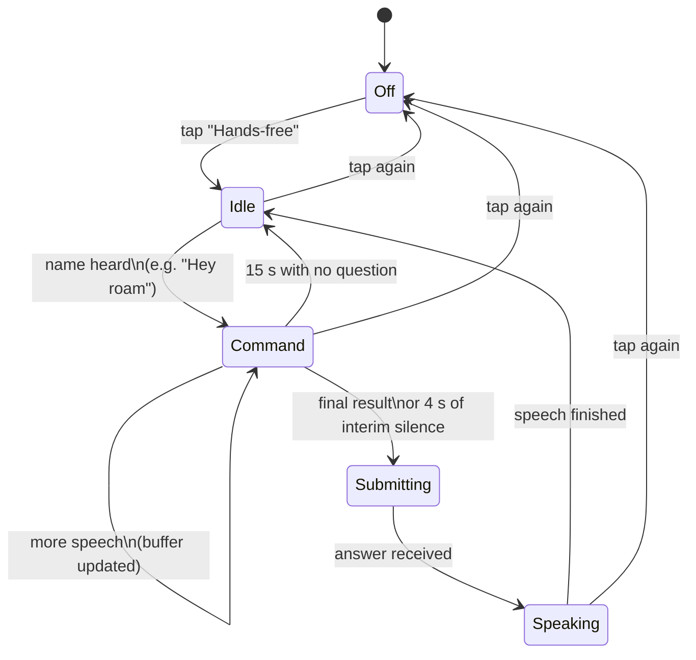

# Hands-free wake word: "Hey roam"

Roam's assistant is named **roam**. Turn on hands-free listening, say "Hey roam" followed by a question, and roam answers out loud without you touching the phone.

---

## Listening starts automatically

roam listens as soon as the page loads. You don't need to click anything first. The first time, Chrome asks for microphone permission; allow it. If the browser needs a tap before it will listen, roam shows a banner, and the next tap or key press starts listening.

The toggle button pauses and resumes listening. Your choice is remembered in this browser.

**Important limit:** listening only works while the page is open and the screen is on. When a phone locks or the tab goes to the background, the browser stops the microphone for web pages. In practice, keep the phone's screen on while you're on the trail (or use a laptop). A phone with the screen off won't hear "Hey roam" with this approach. A native mobile app is the only way to listen with the screen off, and that is outside this project's current scope.

## How it behaves



1. **Idle.** The listener transcribes continuously and looks for any configured wake word at a word boundary. "When" and "wrenches" do not trigger it. "Hey", "hi", "hello", "okay", "ok" and "yo" before the name are accepted but not required, and each letter of the name may be stretched the way recognisers transcribe a drawn-out word, so "roaam", "roooam" and "roaaammm" all count as "roam".
2. **Command.** Speech after the name is captured as the question. **The question does not have to repeat the wake word** - saying the name once opens a 15 second window, and anything you say in that window is taken as the question. Interim results update the buffer; a pause mid-sentence does not cut the question in half, because submission waits for the recogniser's final result (with a 4 second fallback if the browser never sends one).
3. **Speaking.** The listener stops while roam speaks, so it does not transcribe its own voice through the speaker. It restarts when the answer finishes.
4. **Mic in use.** If the push-to-talk button is active, hands-free listening stops, because both need the microphone.

If you say only the name and then go quiet, roam waits fifteen seconds for a question and then returns to idle.

## Choosing the name

The name is configured on the server, not hard-coded:

```bash
ASSISTANT_NAME=roam
WAKE_WORDS=roam,rome,rom
```

**Choose a name with these properties:**

- Two syllables or fewer, so it's quick to say on a trail.
- Not a common English word in outdoor speech. "roam" is a bird, so it fits the theme.
- Easy to recognise. Speech recognisers often mishear names that are very short or that rhyme with common words.

The default list is `roam,rome,rom`. Matching stretches each letter, so you do not have to spell out every variant (`roaam`, `rooom`, `roaaammm` are covered automatically). Test with your own voice and accent, and adjust `WAKE_WORDS` if your recogniser consistently hears something else. Keep the list short: each extra word is another chance for a false trigger.

## Browser support

| Browser                   | Hands-free | Notes                                                                                                                                       |
| :------------------------ | :--------- | :------------------------------------------------------------------------------------------------------------------------------------------ |
| Chrome (desktop, Android) | ✅         | Recommended                                                                                                                                 |
| Edge (desktop)            | ✅         | Same engine as Chrome                                                                                                                       |
| Safari (iOS, macOS)       | ❌         | No Web Speech recognition for this use. Use push-to-talk or typing                                                                          |
| Firefox                   | ❌         | No Web Speech recognition. Use push-to-talk or typing                                                                                       |
| Any browser, screen off   | ❌         | Mobile browsers pause recognition when the page is backgrounded. Keep the screen on or the page visible while you're waiting for a question |

When the browser lacks support, the hands-free control stays off and explains why. Push-to-talk and typing keep working.

## Privacy: what leaves the device

In Chrome and Edge, Web Speech recognition is performed by the browser vendor's speech service, so audio is sent to that service. The app cannot change this. The app's own privacy guarantee applies to everything after the words are recognised: the question text goes to whichever LLM endpoint you configured, and with Ollama that endpoint is on the device.

If you need the wake word itself to be fully offline, see the roadmap below.

## Known limitations

- **Accuracy depends on the browser and the environment.** Wind, a pack strap rubbing the mic, and other voices all reduce accuracy. Earbud mics help.
- **No always-on background listening.** Browsers do not let a web page listen with the screen off. This is a platform limit, not something the app can work around. A native app would be needed.
- **Continuous recognition sometimes stops** after a period of silence or on network drops. The listener restarts automatically after 400 ms while hands-free is on.
- **False triggers are possible**, especially if a wake word is also a common word in your conversation. Because letters are stretched when matching, the short default `rom` also matches `room`, so sentences such as "is there room in the shelter" can open the question window. If that misfires, set `WAKE_WORDS=roam,rome` on the server and reload.
- **Speaking over roam** is unreliable. Let it finish, or tap the hands-free control to pause it.

## Offline upgrade path

The Web Speech approach is quick to build and works on laptops and Android. For a truly offline wake word, the planned replacement is an open keyword-spotting model running in the browser or on the server:

- **openWakeWord** (Apache-2.0): small, open models for custom wake words. Would need a short training run for "roam".
- **Vosk** (Apache-2.0): offline recognition with small models. Could run keyword spotting by matching against a constrained grammar.

Either would let the wake word run with no network and no vendor speech service. The integration point is `startRecognition()` in `public/app.js`: swap the recogniser behind the same `handleWakeResult(text, isFinal)` interface, and the state machine stays the same.
